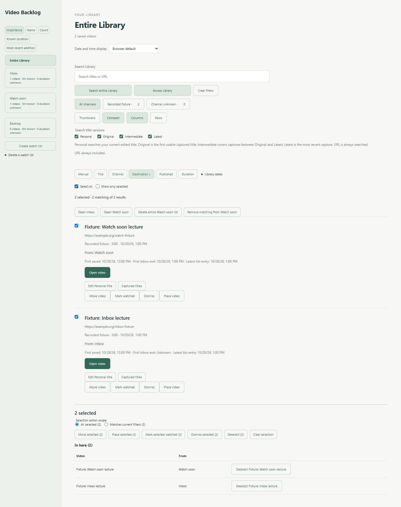
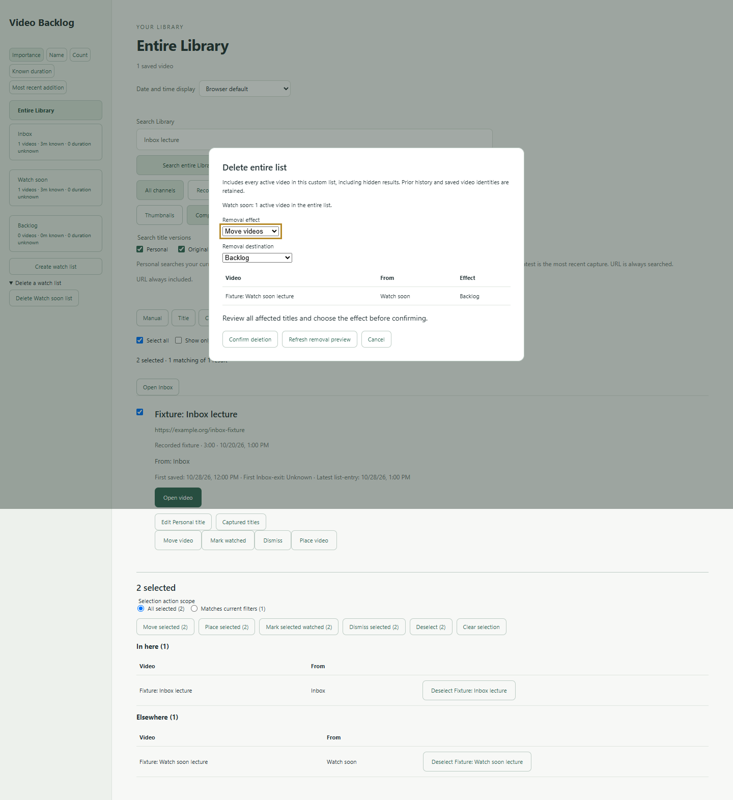

# Library organization validation

Validated 2026-10-29 for [PR #57](https://github.com/Omriy123/youtube-backlog-tracker/pull/57), implementing the [approved specification](../specs/library-organization.md) through issues #52–#56. The [organization guide](../library-organization-guide.md) describes the resulting behavior.

## Final integrated checks

The final implementation passed **40 public-command boundary tests and 111 installed-Chrome browser tests** (`npm.cmd test`, browser run 3.9 minutes). The package build passed. This checkpoint includes all 14 regressions added during final review. The reviewed code was merged without conflicts into the integration branch at `ef2e658`.

A fresh `npm.cmd run validate:chrome` against the integrated source passed capture, retained-title search, rediscovery, opening and recovery through **two browser-process restarts**. It used desktop **Chrome 155.0.8059.41**, isolated extension storage and actual browser tab APIs. The original first-slice coverage remains documented in the [earlier validation report](first-slice.md).

Independent Standards and Spec reviews examined the complete change from `main`. The Standards review found no hard violations and suggested centralizing Manual-order storage; that helper is now shared. The Spec review found two defects: global sorts were regrouped by destination, and later decisions could assign dates to historically unknown First Inbox-exits. Both were corrected in one implementer branch and independently rechecked with no remaining findings. See [review-fix evidence](organization-review-fixes.md).

After integration, the original reproductions confirmed Destination ascending order `Alpha, Backlog, Inbox, Zebra` and descending order `Zebra, Inbox, Backlog, Alpha`. Public move, Mark watched and Open commands each preserved an existing unknown historical First Inbox-exit as `null`. Regression tests additionally verify genuine initial decisions, Undo eligibility, deletion-to-Inbox, rediscovery and exact temporary insertion across destinations.

## Feature evidence

| Delivery | Detailed evidence |
| --- | --- |
| #52 Watch lists, importance, explicit moves and recovery | [Lists and placement](watch-lists-placement.md) |
| #53 Sorts, saved Manual and temporary arrangements | [Sorting and arranging](organization-arrangement.md) |
| #54 Channel browsing, reversible scopes and responsive groups | [Browsing and presentation](channel-browsing.md) |
| #55 Accumulated selection, split batches and explicit status decisions | [Collected selection](collected-selection.md) |
| #56 Full-list deletion and matching-only cleanup | [Removal and recovery](list-removal.md) |

Combined synthetic workloads cover approximately **1,000 active videos / 100 channels / 8 custom lists**, and **1,900 active / 3,000 total videos / up to 550 channel slots / 24 custom lists**, including retained activity, missing metadata and skewed membership. The per-ticket reports record observed measurements; these are individual automation samples, not latency or capacity guarantees.

Responsive checks cover 2560x1440, 1440x900, 1280x500, 390x844 and 768x1200 CSS pixels. Actual Chrome zoom at 125% and 150% also verifies reachable controls without horizontal root overflow. Native automated mouse dragging verifies visible endpoints; keyboard/button Place verifies exact positioning.

## Final screenshots

These screenshots use explicitly labeled synthetic fixtures in an isolated Chrome profile at a 1440x1000 CSS viewport. Both were visually inspected. They contain no personal Library data.

Entire Library with descending Destination order and selection across destinations:

Full-list deletion previews the Watch soon video even while the query matches only Inbox. The effect and destination were explicitly chosen; no deletion was executed for this screenshot:

## Reproduction and retained artifacts

Use the commands in [development and validation](../development.md), setting `CHROME_PATH` to the installed executable to run the browser suite in desktop Chrome. Tests use the existing public Library command and installed-extension/browser-persistence boundaries. Synthetic metadata and deterministic failure adapters are test fixtures, with no production testing hooks.

Local-only evidence is retained outside disposable implementer worktrees:

- `.scratch/validation/library-organization/review-fixes/`: execution summary, final output tail and browser artifacts for the 40 + 111 checkpoint. Earlier streamed stdout is not a complete filesystem log.
- `.scratch/validation/actual-chrome/run-urgeyv/`: final restart walkthrough, result JSON and five screenshots.
- `.scratch/validation/organization-browse/`, `.scratch/validation/organization-selection/` and `.scratch/validation/organization-removal/`: workload, viewport and zoom artifacts referenced by the detailed reports.
- `.scratch/implementation-context/organization-53-metrics.json`: preserved arrangement measurements.

These ignored paths are local evidence, not published download links. Tracked screenshots above remain available in the PR and repository.

## Evidence limits

Checks ran in headless installed desktop Chrome with actual extension storage, tabs, scrolling and browser zoom. They do not establish physical mouse/trackpad comfort, edge-scroll dragging ergonomics, subjective responsiveness on the owner's hardware, manual installation persistence, other browsers or provider playback/acquisition. Those limits do not change the automated outcomes reported here.
