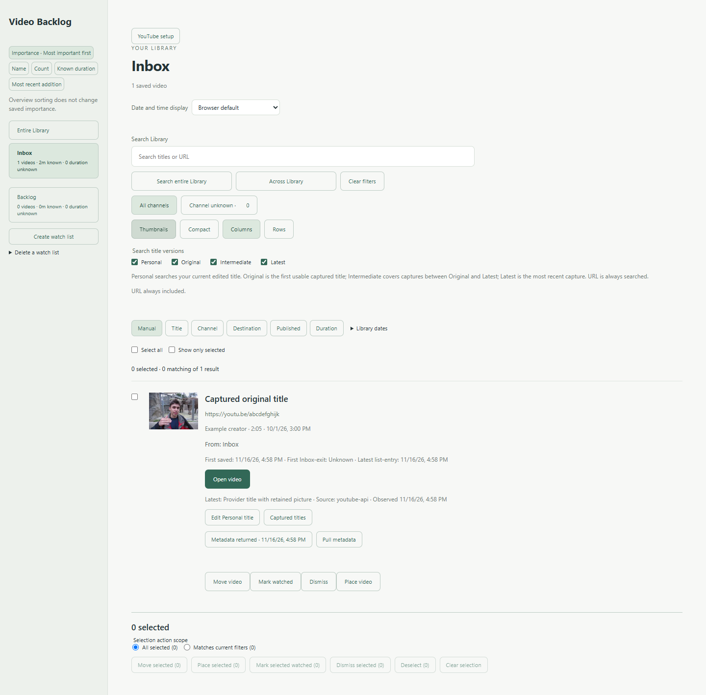

# Manual YouTube enrichment validation

Delivery: [PR #68](https://github.com/Omriy123/youtube-backlog-tracker/pull/68), implementing the [approved manual-first slice](../specs/manual-youtube-enrichment.md) through #65–#67. The [trial guide](../manual-enrichment-guide.md) explains setup and public workflows.

## Evidence boundary

The owner confirmed that no personal YouTube API key is currently available and requested setup instructions. Those instructions are included in the Library and portable build. **Authenticated live YouTube acquisition is pending.** Controlled provider responses establish parser, UI, persistence and failure behavior; they do not establish an authorized API request or live resource availability.

The recognizable thumbnail fixture was downloaded from a public YouTube image URL and supplied at the controlled HTTP boundary. The extension's real image acquisition/encoding and local persistence code processed it. Fictional titles, descriptions and channels accompany it; this is image-byte/rendering evidence, not metadata acquisition evidence. Fixture provenance is recorded in `tests/fixtures/README.md`.

## Initial single-video checkpoint

- Baseline before implementation: 40 public-command tests and 117 bundled-Chromium browser tests passed.
- The first integrated single-video implementation passed 46 public-command tests and an installed desktop-Chrome fixture walkthrough including setup rejection/acceptance, explicit Test connection, retrieval, unchanged original display title, local image bytes, browser-process restart and offline details.
- Additional checks brought the boundary count to 48 and verified unsupported links skip before setup and no-resource checks preserve prior successful values.
- Full regression caught empty per-row status regions making the page status ambiguous. Revealing those regions only during deliberate retrieval fixed all 14 targeted installed-Chrome opening/recovery/browsing/enrichment cases. The final integrated run below supersedes this intermediate checkpoint.
- Early independent core review found corrupt MIME-labelled image bytes accepted as retrieved. Resolution and final verification must be recorded before readiness.

## Reference comparison

References: [accepted Library layout](../design/library-layout.md) and [pinned provider prototype A](../prototypes/provider-availability.md). Actual archived desktop/narrow reference images were inspected alongside rendered extension screenshots. The product retains sidebar/list navigation, existing density and scope controls, original-first row title, retained image target and a compact check-evidence button opening details. The prototype's fictional image blocks are replaced with retained image bytes or an honest missing-image state. No theme/color decision is inferred.

The initial desktop screenshot shows the acquired image, original capture title and differing latest provider title. The initial narrow dialog shows last-success/check evidence and source/time. These are intermediate #65 views; final full-version and operation views belong below once integrated.

## Final integrated checks

Pending completion of browsing/search and batch workflows, whole-branch review, final checks and packaging. This report does not yet claim PR readiness or all ticket acceptance criteria satisfied.

## Human-test and real-use follow-up

Use the exact final portable folder named in the PR handoff and keep the existing extension installed when updating. Copy into the same loaded extension directory, Reload in `chrome://extensions`, then close/reopen Library views. No metadata backups exist in this slice.

[Metadata storage review #35](https://github.com/Omriy123/youtube-backlog-tracker/issues/35) remains unstarted until actual owner use of a qualifying build. No first-use or +28-day date is invented from implementation, fixtures or packaging. Weekly-refresh and backup evidence remains postponed. The separate recovery review is not started by this delivery.
