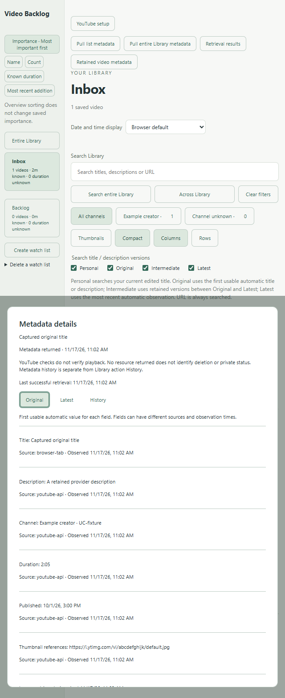
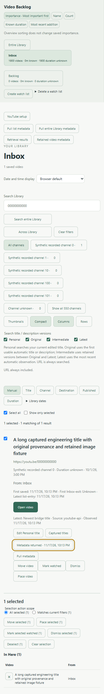
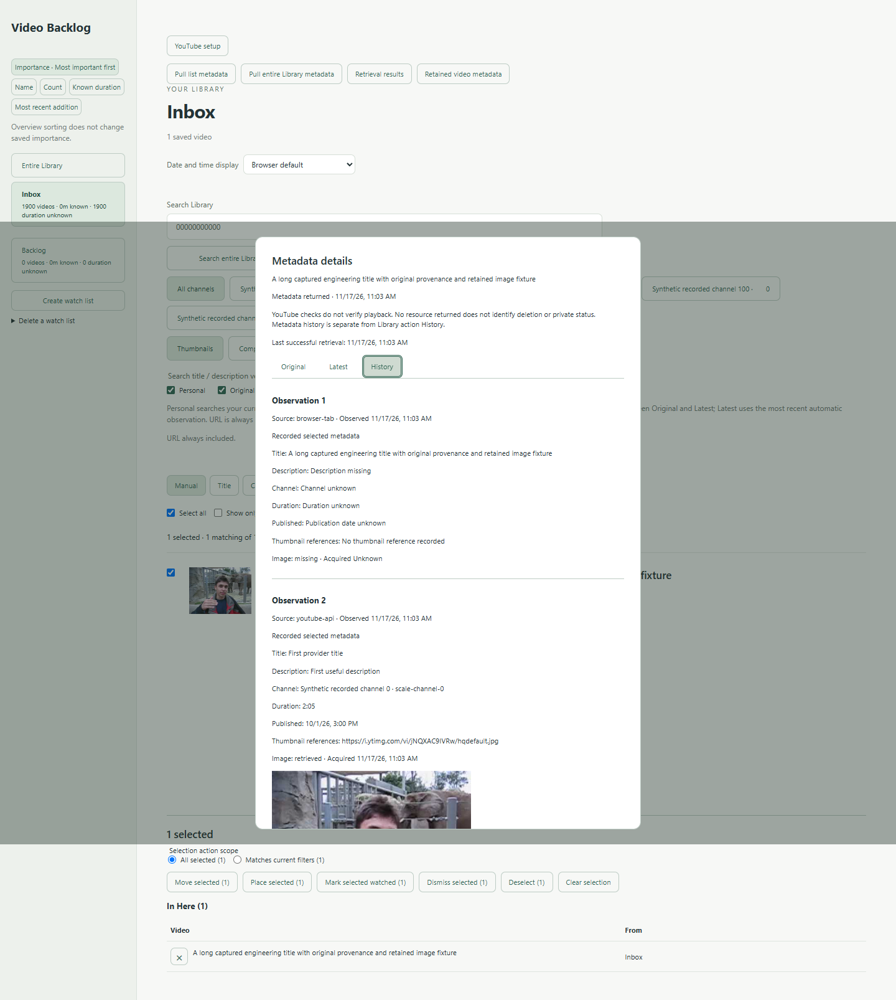
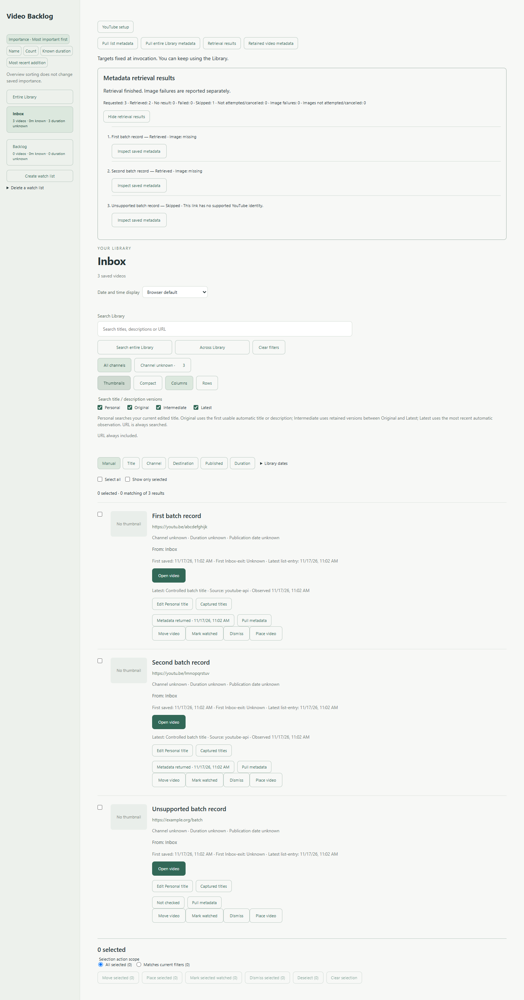
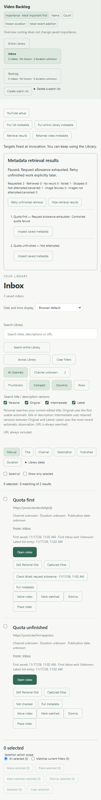

# Manual YouTube enrichment validation

Validated 2026-11-17 for [PR #68](https://github.com/Omriy123/youtube-backlog-tracker/pull/68), implementing [the approved manual-first slice](../specs/manual-youtube-enrichment.md) through #65–#67. Application and test source: `9dbb8af`. The [trial guide](../manual-enrichment-guide.md) covers setup and supported actions.

These full-slice results are the baseline. The subsequent [setup-request repair](youtube-setup-request.md) records the corrected API field selection, newer targeted checks and an accepted authenticated connection test.

The owner's subsequent real-use report confirmed working metadata retrieval with partial thumbnail failures. The [thumbnail fallback repair](thumbnail-fallback.md) records that report, its reproduction and the repair's checks. That report supersedes the connectivity-only status below; owner acceptance of the repaired thumbnails remains pending.

## Evidence boundary

**The full live saved-video/image workflow still needs owner retesting.** The initial trial had no personal API key. After the owner supplied one for bounded diagnostics, the corrected connection request was accepted with HTTP 200 in installed Chrome; see the [repair evidence](youtube-setup-request.md). Controlled provider responses still establish most persistence, image and browsing cases, not a completed live owner workflow. The PR remains draft for that remaining check.

The recognizable JPEG fixture was retrieved from a public YouTube thumbnail URL, then supplied at the controlled HTTP boundary. Production image fetching, native decoding, encoding and local persistence process those bytes. Associated titles, descriptions and channels are fictional. Fixture provenance is in `tests/fixtures/README.md`; screenshots contain no owner Library data or credentials.

## Baseline full-slice checks

| Check | Result |
| --- | --- |
| Public Library command boundary | 62 passed |
| Complete installed-Chrome browser suite | 126 passed in the final complete run (4.3 minutes) |
| Production extension save/find/open/recover | Passed on Chrome 157.0.8103.50 through two process restarts |
| Focused independent-review fixes | 20 boundary and nine installed-Chrome tests passed |
| Portable build | Passed; manifest 0.1.0, installation instructions and enrichment guide included |
| Authenticated YouTube known-ID request | Not performed in the baseline; later connection check accepted, see repair report |

The complete suite covers ordinary no-key capture/opening/organization, optional setup, retained metadata and image bytes, restart/offline inspection, independent version scopes, historical descriptions and exact-version navigation, missing fields, key replacement, quota/network/no-resource and storage failures, cancellation, image-only retry, interrupted operations, concurrent user actions and recovery. It verifies public workflows and observable retained records rather than private helpers.

A preceding run encountered one 30-second close-notice timeout without a diagnostic location. That case passed three subsequent isolated traced runs and the final complete run passed all 126 cases. Earlier integrated failures exposed global notice selectors targeting a prepended hidden status, and unstable test interaction timing. Main-notice scoping, exact-tab URL polling, completed-dialog waits and explicitly visible native drag endpoints corrected those reproductions without weakening their outcome assertions.

The production Chrome restart evidence is retained in [chrome-restarts.json](manual-enrichment/chrome-restarts.json). Automation registers the unpacked extension on each launch in an isolated profile; it does not establish manual installation persistence or provider playback.

## Independent review

### Standards

One documented-standard finding: selected metadata tabs originally depended on background color. A stable double border now distinguishes selection independently of color and preserves `aria-pressed` and control dimensions. The reviewer inspected desktop/narrow rendered evidence and confirmed resolution. No substantive Fowler heuristic findings remained.

### Spec

Three confirmed findings were fixed in one implementer branch and independently rechecked:

- Empty/whitespace Save key now rejects replacement and preserves the configured key and in-flight work. Explicit Remove key remains separate.
- Cancelling during a text request permits its returned text to persist, stops a later image request, records the image as cancelled/not attempted and offers image-only retry. An image already in flight retains its truthful outcome.
- Corrupt MIME-labelled image bytes now fail native decoding before acquisition is accepted, while successful text remains retained and the image can be retried.

The final notice-targeting and test-stability patch also received a read-only review with no concrete remaining finding. Review resolution does not substitute for the pending authenticated integration check.

## Rendered reference comparison

References: [accepted Library layout](../design/library-layout.md) and [pinned provider prototype A](../prototypes/provider-availability.md). Actual archived desktop/narrow reference images were compared with the rendered extension.

Sidebar navigation, independent scope controls and existing row actions remain recognizable. Thumbnails use retained image bytes or honest missing-image text; Compact preserves readable channel/date/duration values. Original-first titles stay stable beside a differing latest title. The quiet check-evidence control opens Original/Latest/History with factual source/time and every retained observation. Historical-only excerpts lead to their exact version. Version selection now has a non-color border marker.

Desktop/narrow checks cover both densities, long titles, selected rows, unknown values, metadata/history dialogs and paused/retry results without root horizontal overflow. Keyboard activation and dialog-end controls are exercised. Native drag evidence explicitly keeps both endpoints visible; offscreen scrolling and physical mouse/trackpad comfort remain human checks under the existing interaction follow-up.

## Representative workloads

Synthetic workloads cover 1,000 active/1,000 total records across 100 channel slots, and 1,900 active/3,000 total records across up to 550 channel slots. They include retained statuses, unsupported links, multiple versions and missing values. Results render 100 targets initially with explicit expansion, while counts account for the whole frozen set.

Measured observations are retained in [metadata browse measurements](manual-enrichment/metadata-scale.json) and [batch snapshot/cancel measurements](manual-enrichment/batch-scale.json). They are individual headless-browser samples, not authenticated provider throughput, storage capacity or latency guarantees. Real-use memory/storage/request evidence remains with the four-week review.

## Human-test handoff

Use the exact portable folder identified in the PR/final handoff. For an existing installation, copy its new `extension/` contents into the same folder already loaded in Chrome, choose Reload in `chrome://extensions`, then close/reopen Library views. Keep the extension installed and preserve its storage. This slice has no metadata backup/export, automatic refresh or clearing control.

Try no-key saving first. Then create a personal key following YouTube setup, Test connection, pull one real saved video, inspect metadata/history, and reopen offline. Try list/Library retrieval, cancellation and explicit retry. Report visible versus expected results without including the key.

[Metadata review #35](https://github.com/Omriy123/youtube-backlog-tracker/issues/35) remains unstarted until actual owner use of a qualifying build. No first-use or +28-day date is inferred from fixtures, packaging or issue closure. Weekly-refresh and backup evidence awaits later delivery; the separate recovery review is not started here.
