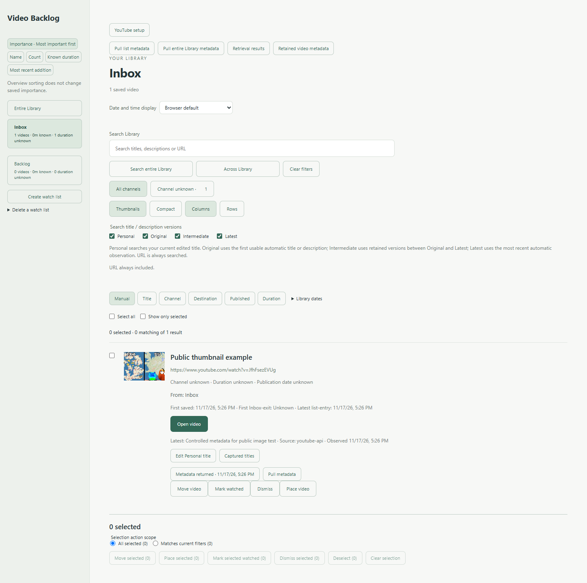
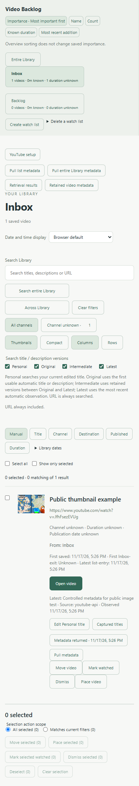

# Thumbnail fallback repair

Owner feedback on 2026-11-17 after the `0.1.0` / `f53feb4` handoff:

> thumbnails don't appear for every vid.
> rest seems to work correctly

Example: `https://www.youtube.com/watch?v=JfhFsezEVUg`. The owner saw no usable image in Original details; image-only retry reported `imageOnly. Image: failed.` The retained references began with `fhddefault.jpg`, then `maxresdefault.jpg`, followed by SD, HQ, MQ and default sizes. Installed revision was not independently inspected.

## Reproduction and cause

Credential-free public requests returned HTTP 404 for the exact FHD reference and HTTP 200 for the maxres reference. Production image fetching in an isolated installed-Chrome background worker decoded maxres (249918 bytes), SD (97404), HQ (25446) and default (3569) successfully.

A temporary browser reproduction supplied controlled metadata with the owner's reference ordering and used production fetching, decoding, storage and UI for the real public image. Before the repair it failed because no Library thumbnail appeared. Removing only the first reference made the image appear and survive reload. The service tried only the first retained reference, so an image-only retry repeated the same unavailable URL.

## Repair and evidence

Deliberate acquisition now tries the supplied references in order until one image is acquired. It records the URL actually acquired, retains all references and history, and shares the behavior between normal retrieval, image-only retry and batch operations. Cancellation and credential revision are checked between attempts; an in-flight image can still complete truthfully. No successful text lookup is repeated by image-only retry.

- The public-command regression failed before the fix: expected image `retrieved`, received `failed`. It passes after the fix for full retrieval, image-only retry and reopening retained data.
- Additional public-command checks cover a key replacement after an image failure and cancellation before a fallback request, followed by explicit batch image-only retry.
- The installed-Chrome HTTP fixture covers an unavailable highest-resolution reference, retained text when every image fails, successful image-only fallback without repeating text, and visible retained images after reload.
- The original reproduction now passes with the FHD reference still first: the real 1280-pixel maxres image is visible and remains after Library reload. Metadata is controlled; this is public-image evidence, not a fresh authenticated metadata lookup.
- Focused read-only code review found no actionable defects in fallback, cancellation, credential changes, retention or result handling.

Final verification: **66 boundary checks and all 128 installed-Chrome browser workflows passed**. The complete `npm test` run passed its then-current 65 boundary checks and 128 browser tests (4.6 minutes); after adding the between-attempt cancellation regression, the entire boundary suite passed 66/66. Production code did not change between those runs. Results are also recorded with the delivered revision in PR #68 and `BUILD.txt`.

Rendered evidence uses the real public image with controlled metadata and an otherwise empty synthetic Library. Desktop and narrow inspection confirmed that the recovered picture is visible and existing controls remain reachable. This repair changes acquisition only; the Library layout is unchanged.

## Owner retest and limits

Update the existing installed folder and Reload in Chrome. For the example video, choose **Retry thumbnail only** in Metadata details; the thumbnail should appear without another text lookup. For a failed batch, **Retry unfinished retrieval** uses the retained references. If every supplied image is unavailable, the result remains an honest image failure with text retained.

No personal credential was accessed or used during this repair. No authenticated API requests were made. Temporary diagnostic extensions and profiles used only synthetic setup values. Owner acceptance of repaired thumbnails and physical pointer comfort remain human checks; PR #68 stays draft.

The owner's actual metadata use starts the existing #35 observation period on 2026-11-17, due 2026-12-15. Backup and weekly refresh remain deferred; this does not start the separate recovery review.
