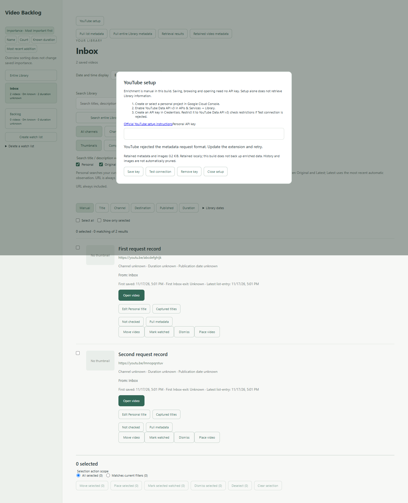
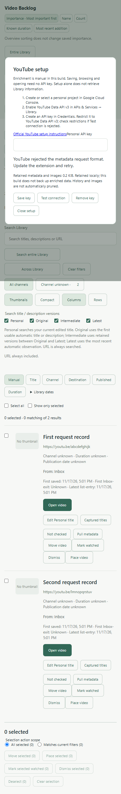

# YouTube setup-request repair

Validated 2026-11-17 for current-build feedback on [#65](https://github.com/Omriy123/youtube-backlog-tracker/issues/65#issuecomment-6944190660) and [draft PR #68](https://github.com/Omriy123/youtube-backlog-tracker/pull/68). Repair code/test source: `ec089f288d9d0dc330763b5b7ff1a42690f61fe7`. This is a bounded repair to the approved setup/retrieval contract, not a scope change.

## Report and confirmed cause

The owner reported: “YouTube rejected setup. Check the API key, enabled YouTube Data API and key restrictions.” The installed revision was not independently inspected; the problem was reproduced against the handed-off artifact at fb5bc82, whose provider code remained unchanged at the later a2e5326 PR head.

The request included `error(code,errors(reason))` in its successful-response `fields` selector. `error` is not a property of `VideoListResponse`. An authorized bounded live request reproduced HTTP 400 with a safe invalid-field-selection flag. The application then incorrectly classified every HTTP 400 as rejected setup.

The corrected selector requests only the selected video resource fields. Error envelopes are still parsed separately on non-success responses. Other request-format failures now receive a distinct static message and pause a batch before its next target. Genuine credential/setup failures, including structured invalid-key HTTP 400 responses, retain their separate classification. Neither case displays or retains raw provider error messages, which may reflect credentials.

Sources checked: the official [videos.list response](https://developers.google.com/youtube/data/reference/rest/v3/videos/list#response), [partial response syntax](https://developers.google.com/youtube/data/getting-started#fields), and the public YouTube discovery schema. The discovery response's VideoListResponse properties do not include an error envelope.

## Verification

- The installed-Chrome HTTP fixture now rejects the illegal selector instead of accepting every request shape. Its existing setup test reproduced the owner's exact message before the fix, then passed with the corrected request.
- A new browser regression verifies a request-format failure does not blame setup, reflect the supplied fixture credential, or continue through the rest of a batch. A structured invalid-key HTTP 400 public-command regression preserves genuine setup rejection and leaves the Library unchanged.
- **All 63 public-command boundary tests pass. All 10 affected installed-Chrome browser tests pass**, covering setup, metadata/image retention, cancellation/image-only retry, quota, batch results, retained history, review gates and representative browsing workloads. The earlier full-slice baseline remains 62 boundary/126 browser tests; that entire suite was not repeated for this narrow repair.
- One existing cancellation test initially started a batch before capture completion. It now waits for the public Saved to Inbox result, preserving its intended cancellation precondition and outcome assertions.
- A focused independent code review found no actionable defect in the request, classification, pause and redaction changes. Desktop and narrow fixture rendering preserve the existing setup dialog and readable text-only distinction.

## Authorized live connection evidence and credential handling

The owner authorized up to two connection requests. Exactly two were used: the original request reproduced HTTP 400; the corrected build's Test connection was accepted with **HTTP 200** in **Chrome 157.0.8103.50**, using the owner's updated designated key entry. The second check enforced a one-request ceiling and used a fresh isolated Chrome profile. That temporary profile was deleted afterward.

No key values, headers, raw provider responses or real-request traces/screenshots were published. The test does not establish a completed saved-video metadata/image workflow. The owner still needs to update the installed build, save the current replacement key in YouTube setup and pull metadata for a real saved video. The PR stays draft for that remaining check. The requested key-rotation reminder is part of the human handoff.

Test connection leaves Library records untouched. It is not actual owner enrichment use, so [#35](https://github.com/Omriy123/youtube-backlog-tracker/issues/35) still has no first-use/+28-day dates; the separate recovery review is not started.

## Rendered evidence

The screenshots use controlled failures and fictional records, not the real key or its response. Both widths retain the approved setup layout and reachable controls without page-level horizontal overflow. The public test also verifies the reflected fixture credential is absent from the visible message.

